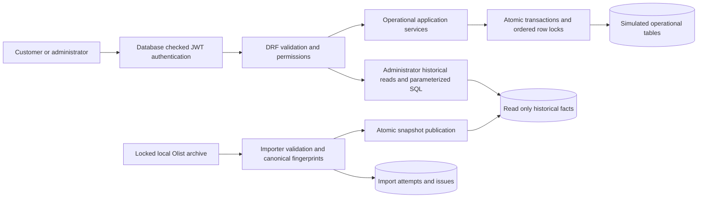
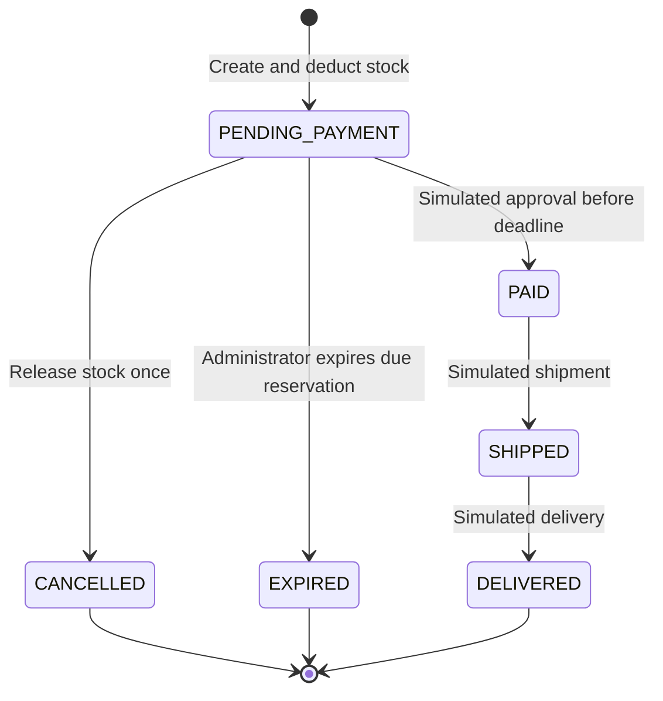

# Architecture and relational integrity

The service has two explicit data domains in one Django project. Their tables, routes, identities and rules remain separate. Deployment environments then isolate the large historical analysis dataset from the small operational demonstration. [ER diagrams](olist/data-model.md), the [source dictionary](olist/data-dictionary.md) and [generated PostgreSQL schema](../sql/schema.sql) describe the implemented relational structures.

## Modules and responsibilities

| Module | Responsibility |
| --- | --- |
| `accounts` | Django users/hashed passwords, fictional customer profiles, JWT/current-account checks, self/admin permissions |
| `catalog` | Fictional products, sellers and seller/product offers; positive simulated prices; shared parent lock hierarchy |
| `inventory` | Per-offer available balances and actor-attributed stock movements; supply/correction and cancellation headroom |
| `orders` | Order creation, immutable purchase snapshots, integrity checks and permitted lifecycle services |
| `olist` | Source-only models/clock field, validated import, administrator read APIs, fixed SQL reports and isolated benchmark |
| `common` / `config` | Input fields/limits, English errors, private responses, role configuration, settings, routes and OpenAPI |

Serializers validate JSON shape/types; services validate current actors and business state inside explicit transactions. Models/migrations enforce relational/local invariants. Views orchestrate these parts without reimplementing stock or transition rules. No generic repository layer, queue, microservice split or external payment dependency is needed for this scope.

## Historical relationships and meaning

`olist_customer.source_customer_id` preserves source `customer_id`; `customer_unique_id` groups repeat identities across customer references and is intentionally nonunique/indexed. Historical customers are unrelated to login users. Product and seller source keys are preserved. An order references one source customer; its items reference both product and seller, so multi-seller orders and repeated product lines are valid. An order can have multiple payment records and even missing item/payment sides.

Natural source keys are unique alongside surrogate bigint PKs. Item uniqueness is `(order, source_order_item_id)` and payment uniqueness `(order, payment_sequential)`. Historical item sequence is not quantity. Category identity is the union of supplied translations and observed nonblank category keys; missing category and missing English translation remain different states. Source prices/freight live on historical items, never as current catalog prices.

Native `timestamp without time zone` fields retain the source clock plus raw source text. No verified source timezone is invented. Operational events use aware UTC datetimes. Source statuses and representable anomalies are preserved with issue records. A singleton check/unique key permits one accepted snapshot per database; different snapshots require a fresh isolated target. Publication commits validated rows and its completed marker together. Canonical fingerprints cover mapped fields and natural-key relationships, excluding surrogate identity differences between environments.

## Operational relationships and enforcement

| Rule | PostgreSQL enforcement | Service/API enforcement |
| --- | --- | --- |
| One profile per account; valid references | Unique/one-to-one keys; protected FKs | Self-only profile; owner-scoped order lookup; current active role checks |
| One offer per seller/product | Composite unique constraint; immutable-parent trigger | Offer creation/activation and price validation; initialize stock at zero |
| Positive finite prices, integer quantities, nonnegative stock | Numeric/range/check constraints and integer column types | Strict JSON integers; decimal arithmetic; item/offer/order limits |
| Purchase history survives catalog changes | Protected references and immutable offer association | Snapshot SKU/name/seller/unit price at purchase; never recalculate old totals from current prices |
| Valid lifecycle row shape | Status/timestamp and chronology checks | Nonempty order, cross-table totals/ledger/payment/shipment consistency, allowed transitions |
| Cancellation once per offer | Partial unique `(order, offer, movement_type)` reservation/release key | Lock order, reject nonpending cancellation, preserve original release/time on consistent repetition |
| Stock balance equals audit movements | Signs, movement context, actor/order FKs | Atomic balance+movement writes, reconcile existing history and preserve cancellation capacity |

Foreign keys use Django `PROTECT` on audit/history references; database FKs reject dangling references even when ORM deletion is bypassed. The API provides no hard-delete routes. Deactivate products/sellers/offers/customers for future operations rather than rewriting past purchases. The inventory ledger and purchase snapshots are immutable through the API, **not** a claim that privileged raw SQL cannot change them. Some cross-table rules cannot be ordinary row CHECK constraints; they are explicitly service invariants.

## Stock strategy and concurrency

Creation deducts available units and appends a negative `RESERVATION` per offer in the same transaction as order/items. Any insufficient line or failed write rolls back the whole order. Only `PENDING_PAYMENT` can cancel; cancellation appends positive `RELEASE` movements and restores units once. Payment/shipping/delivery do not change stock. Physical on-hand units are not separately modeled. New orders have a fixed 30-minute payment deadline; legacy NULL deadlines remain unchanged. A bounded administrator command expires due pending orders in separate transactions, restores stock once and records EXPIRED/expired_at using the existing release ledger. PostgreSQL wall time is checked after locks; overdue payment is rejected without auto-expiring. Headroom still includes all pending orders until real release. [Expiry rules](reservations/design.md) define the cutoff, SKIP LOCKED omission, actor rechecks and partial-failure report. An optional fixed-delay worker reuses this service through a separate Compose overlay, with fresh connection/authorization each cycle, per-session timeouts, graceful between-order stop and observational backlog. Default startup and CI leave it disabled; [operations](worker/operations.md) explain retry/stop/monitoring limits.

All conflicting catalog/inventory/order services lock in the same hierarchy: **optional creation-key advisory lock → existing order → sellers ascending ID → products ascending ID → offers ascending ID → stock ascending offer ID**. Locking queries are evaluated explicitly; mutable activation, prices and balances are reread after locks. PostgreSQL READ COMMITTED plus these row locks prevents last-unit overselling and lost balance updates. Parent locks are deliberately conservative and may serialize unrelated offers sharing a seller/product. Inventory checks pending cancellation liability without acquiring orders in the reverse direction. The [operational rules](stage-04/rules.md) define headroom, repeat actions and exact lifecycle.

Optional customer-scoped creation keys serialize even before an order row exists using a bound PostgreSQL transaction advisory lock. A partial unique index on `(customer_id, idempotency_key_hash)` and a null-safe pair/format CHECK protect persisted identity. Both new fields are NULL for legacy/unkeyed orders. Replay rechecks the current customer after waiting, then locks and inspects the existing order without taking catalog/stock locks. Cached purchase items and locked state form a coherent response; current catalog edits do not reprice it. Lifecycle services never acquire creation-key locks. Key/content conflicts return 409; only a committed successful creation consumes a key. Keys have no expiry. See the [contract](idempotency/design.md). Unkeyed creation retries can still duplicate purchases after an ambiguous response. Separate seller suborders, partial cancellation, refunds and real payment/warehouse/carrier integration remain outside scope.

## Database roles, indexes and evidence

Bootstrap `postgres` initializes each isolated cluster. `olist_owner` owns schema/migrations without superuser/CREATEDB; `olist_api` has operational/auth DML and historical SELECT; `olist_importer` inserts historical data with scoped publication/attempt updates, no operational writes; `olist_test` has CREATEDB for disposable tests and cannot assume application/owner roles. After migrations, owner-run `configure_database_roles` applies classified grants; new tables fail closed until classified. The application uses authenticated TCP as the restricted API role, not schema ownership.

The creation-key partial index enforces correctness rather than a measured analytics optimization. Baseline indexes support PKs, unique source/composite keys, FKs, case-insensitive email and repeat identity. The schema dump includes the actual indexes and offer trigger. No redundant performance index is added on speculation. Stage 5 tested a temporary partial covering purchase-date index on an isolated complete Olist snapshot, keeping baseline indexes and query/data fixed. Its 5.356 → 0.080 ms median result, 7.90 MiB cost, control phase and warm-cache limits are in the [actual experiment](stage-05/index-experiment.md). It was removed and is not a migration.

Parameterized SQL preaggregates item/payment facts separately to avoid join multiplication. Seller delivery counts distinct order/seller associations; customer repetition uses `customer_unique_id`; delivered-only sales and missing facts are explicit. See the [twelve-query portfolio](stage-05/sql-portfolio.md). [Tests](testing.md) verify real PostgreSQL constraints, rollback, coordinated separate-connection races and SQL correctness. These boundaries do not establish production hardening or tamper-proof accounting; see [limitations](limitations.md).

## Logical recovery boundary

The optional [recovery drill](recovery/operations.md) keeps a read-only exported PostgreSQL snapshot open across custom dump and full-table hashing. A separate cluster receives only fresh generated data/reference databases, restored as owner with original ownership/ACL commands disabled. Full row/migration equality and identically reparsed DDL are checked before access is granted. Sequence next-ID safety is separate from MVCC row consistency. Cluster credentials, signing secrets and deployment recovery objectives require independent provisioning/planning. Existing source facts and business services are unchanged.
