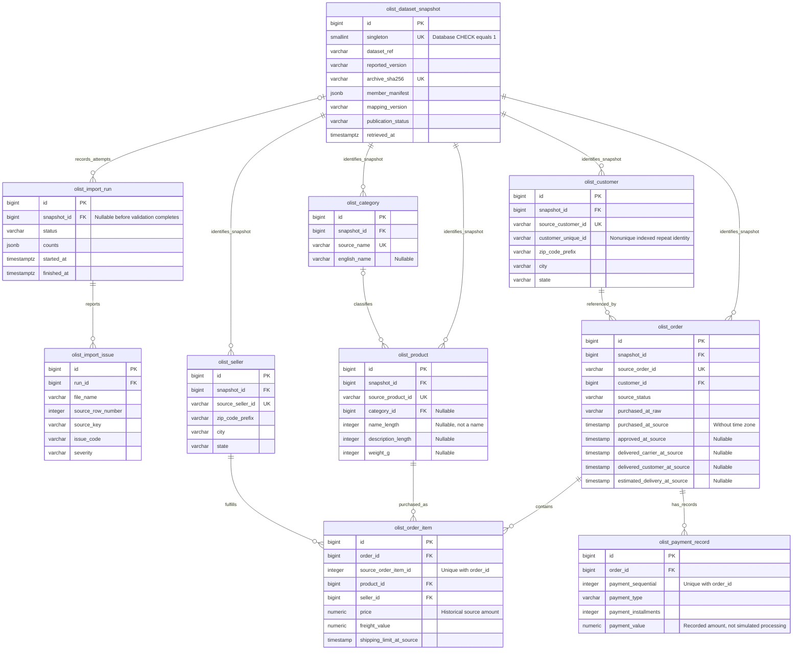
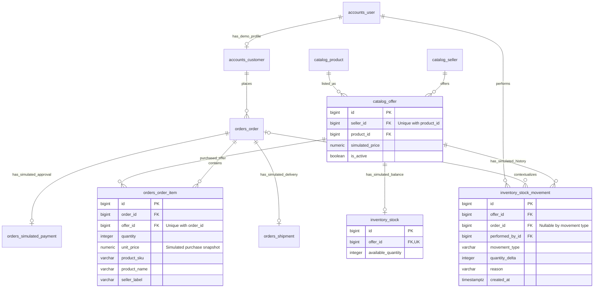

# Olist case-study ER model

Status: implemented as Stage 2 models/migrations in an isolated PostgreSQL database. The diagram highlights core fields; the complete generated DDL is in `sql/schema.sql`. Historical import and operational services remain later-stage work. The initial Stage 1 model stays archived.

## Historical domain

The diagram highlights core fields. All source timestamp columns retain matching raw text, not just purchase time; additional product measurements map as listed in the dictionary. A source order may have zero item/payment rows. Historical customers have no Django user FK. Their `customer_unique_id` intentionally repeats. The archive happens to use one customer row per order; a conventional FK preserves source references without asserting a universal business rule beyond this snapshot.

`DatasetSnapshot` identifies an accepted source. Stage 2 enforces exactly one possible snapshot identity through a nonnull unique `singleton` column constrained to 1, with unique source identifiers. All historical parent relationships use protected FKs. `ImportRun` can exist before a snapshot is accepted. The Stage 3 importer must validate matching source identity and atomically publish completed snapshots with their domain inserts; that workflow is not implemented yet. A future multi-snapshot design would need additional cross-snapshot integrity enforcement rather than relying on separate ordinary FKs.

Historical item uniqueness is `(order_id, source_order_item_id)` and payment uniqueness is `(order_id, payment_sequential)`. Do not add `(order_id, product_id)` uniqueness. Integer sequences must be positive and source money finite/nonnegative, with reviewed numeric widths. Preserve zero payment values and zero installments. Do not apply operational state/timestamp, nonempty-order, exact-payment-total, or simulated-snapshot-name checks to historical rows.

Keep missing product categories nullable. Build category identities from the union of nonblank product category keys and supplied translations, so untranslated categories retain their identity. Their English label stays null; presentation may use an English `Untranslated category` label alongside the original source key.

## Simulated marketplace domain

These table names are now explicit in Stage 2 models/migrations and agree with the SQL export. The offer reassignment trigger enforces immutable seller/product associations, including raw SQL and bulk updates. Operational FKs, positive decimal prices/quantities, nonnegative stock, history protection, and strict lifecycle checks remain. Offer seller/product associations are immutable; changing an association requires a new offer, not rewriting purchase identity. Reservation/release uniqueness changes to `(order, offer, movement_type)`; cancellation headroom is calculated per offer. Names/labels and current prices here are fictional, never fields copied into the historical catalog as facts.

Optional later historical provenance links are deliberately omitted from the core diagram because they are not operational ownership, authentication, or current-merchant relationships. No historical customer-to-login linkage will be created. A demo seed using historical product/seller references must label its projection and synthetic attributes explicitly.

## Constraints, indexes, and locks

Historical baseline indexes include PKs, unique source identifiers, item/payment composite keys, FKs, and a nonunique index on `customer_unique_id`. Avoid duplicate indexes already supplied by uniqueness/FKs. Candidate purchase-date/status/seller-report indexes need new measurements on the actual imported snapshot before adoption as performance improvements.

Simulation locks follow existing order -> sellers by ID -> products by ID -> offers by ID -> stock by offer ID. Catalog activation/price edits and stock changes must follow the same relative order. Historical importer publication uses its own database-scoped lock, and API readers cannot mutate historical facts.

PostgreSQL constraints enforce relational references and local ranges/keys; application services enforce operational cross-table totals, snapshot immutability, legal transitions, and ledger reconciliation. Import validation/reporting preserves historical exceptions instead of forcing operational invariants. The [adaptation plan](adaptation-plan.md) defines the required tests and incremental delivery boundaries.
