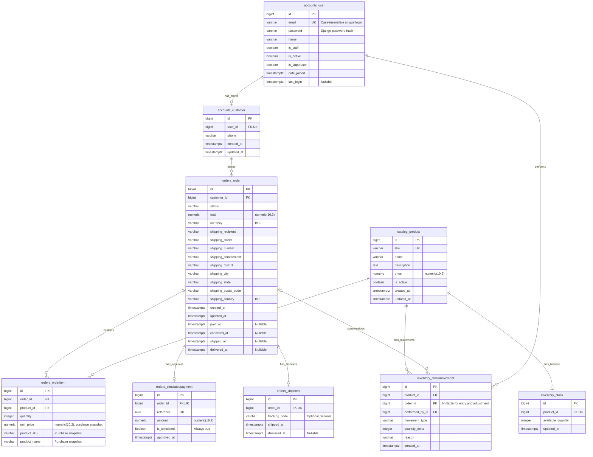

# Stage 1: relational data model

This is the proposed model for review. Table names match the related Django model conventions to support selective reuse. No migrations or SQL schema have been created in this repository. Stage 2 will reconcile this design with actual migration-generated PostgreSQL DDL.

## Entity-relationship diagram

The diagram describes physical FK/unique guarantees: a user has **at most** one customer profile; a product has **at most** one stock row; an order can physically have zero item rows. Registration/product/order services must establish the stronger business existence rules in one transaction. Staff users can have no customer profile. Django authentication permission/group and framework tables are omitted from this domain diagram, but will be included in the complete schema export.

## Relationships and keys

All domain entities use surrogate `bigint` primary keys generated by Django `BigAutoField`. IDs identify objects; they are not authorization credentials. SKU and case-insensitive email are alternate business keys. Do not use mutable product names as keys.

| Relationship | Database representation | Purpose |
| --- | --- | --- |
| User to customer | Unique non-null `accounts_customer.user_id` FK | Separates authentication from customer profile; prevents duplicate profiles |
| Customer to orders | Non-null `orders_order.customer_id` FK | Enables ownership filtering and administrative order access |
| Product to stock | Unique non-null `inventory_stock.product_id` FK | One available balance per product |
| Order to items | Non-null `orders_orderitem.order_id` FK | Multiple purchase lines; no cascading history deletion |
| Product to items | Non-null `orders_orderitem.product_id` FK | Stable product identity for reports, with independent purchase snapshots |
| Order/product item key | Unique `(order_id, product_id)` | No duplicate product line in one order |
| Order to payment | Unique non-null `orders_simulatedpayment.order_id` FK | At most one approved simulated payment per order |
| Order to shipment | Unique non-null `orders_shipment.order_id` FK | At most one shipment per order |
| Product to movements | Non-null `inventory_stockmovement.product_id` FK | Auditable inventory history and reconciliation |
| Order to movements | Nullable `inventory_stockmovement.order_id` FK | Required for reservations/releases; forbidden for entry/adjustment |
| Actor to movements | Non-null `inventory_stockmovement.performed_by_id` FK | Records customer/admin responsible for the stock operation |

Use `on_delete=PROTECT` on these historical model relationships. PostgreSQL FKs reject dangling references even for direct SQL; Django `PROTECT` adds ORM deletion behavior. Neither mechanism prevents a privileged SQL user from modifying or deleting an otherwise unreferenced history row. No domain DELETE endpoints are planned.

## Normalization and deliberate snapshots

Customer identity is not repeated on each item. Product data lives in the catalog, and order/product is modeled through an explicit item table with quantity and price. Stock is separate from product metadata to isolate a mutable balance and its locks; movements form the append-only application ledger.

Purchase-time SKU, name, and unit price intentionally repeat catalog attributes: they describe a historical fact that must survive later catalog edits. The order's address is also a purchase-time fact. `Order.total` is a stored aggregate for a stable purchase contract, enforced by services against the items. Payment amount and shipment times repeat lifecycle facts and must match the order; they are not independent sources to edit.

There is no stored item subtotal: compute `quantity * unit_price`. There is no mutable customer spending counter or second reserved-stock counter. SQL aggregation derives reports and outstanding reservations.

## Planned database constraints

Constraint names below follow inspected conventions; final names/DDL will be confirmed in migrations.

| Table | Constraint or key | Guarantee |
| --- | --- | --- |
| `accounts_user` | `email` unique; `user_email_ci_unique` on `LOWER(email)` | Unique email including case-insensitive identity |
| `accounts_user` | `user_email_not_blank_or_padded`, `user_name_required` | Nonblank name/email; no padded email; full email syntax remains application validation |
| `accounts_customer` | Unique user FK | No second customer profile for a user |
| `catalog_product` | Unique SKU; `product_sku_format`, `product_name_required` | Identifiable, nonblank catalog entries |
| `catalog_product` | `product_price_positive_finite` | Finite `0.01..99999999.99` price |
| `inventory_stock` | Unique product FK; `stock_quantity_nonnegative` | One balance per product, never negative; PostgreSQL integer type supplies its upper bound |
| `orders_order` | `order_total_positive_finite`, `order_currency_brl` | Positive finite total within `numeric(16,2)` range; fixed currency |
| `orders_order` | `order_shipping_address_valid` | Required nonblank address fields, allowed state/country and postal code shape |
| `orders_order` | `order_status_timestamps_valid` | Valid state with exactly its required non-null lifecycle timestamps |
| `orders_order` | `order_timestamps_chronological` | Chronology within that order row |
| `orders_orderitem` | `item_order_product_unique` | Unique `(order_id, product_id)` |
| `orders_orderitem` | `item_quantity_valid`, `item_price_positive_finite`, `item_snapshot_required` | Quantity 1..9999; finite positive price; nonblank historical name and valid SKU |
| `orders_simulatedpayment` | Unique order, unique UUID reference; `payment_amount_positive_finite`, `payment_simulation_required` | No duplicate approval; valid amount; explicitly simulated |
| `orders_shipment` | Unique order; `shipment_dates_chronological` | No second shipment; delivery does not predate shipment |
| `inventory_stockmovement` | `movement_type_sign_order_valid` | Allowed type/sign/order-nullability combinations |
| `inventory_stockmovement` | `movement_delta_symmetric_range`, `movement_reason_required` | Nonzero type-appropriate delta within symmetric stock range; nonblank reason |
| `inventory_stockmovement` | `movement_order_product_type_unique` conditional on reservation/release | At most one reservation and one release per order/product |

Use explicit finite positive upper-bound checks on numeric amounts. PostgreSQL `numeric` can represent special values such as `NaN`; a lower-bound-only check must not be assumed to reject every special value. Verify direct-SQL constraint behavior against PostgreSQL.

State/timestamp combinations:

| State | `paid_at` | `cancelled_at` | `shipped_at` | `delivered_at` |
| --- | --- | --- | --- | --- |
| `PENDING_PAYMENT` | null | null | null | null |
| `CANCELLED` | null | required | null | null |
| `PAID` | required | null | null | null |
| `SHIPPED` | required | null | required | null |
| `DELIVERED` | required | null | required | required |

Movement combinations:

| Type | Delta | Order FK |
| --- | --- | --- |
| `ENTRY` | Positive | null |
| `ADJUSTMENT` | Positive or negative, never zero | null |
| `RESERVATION` | Negative | required |
| `RELEASE` | Positive | required |

## Cross-table guarantees and limitations

Database row constraints cannot prove that an order has an item, its total equals item subtotals, a reservation delta matches a line, a cancelled order has all releases, a payment equals the order total, or a stock balance equals ledger sum. PostgreSQL row CHECK constraints must not be designed as queries over other tables.

Implement these guarantees through validated services, `transaction.atomic()`, ordered product/stock locks, and an order lock for lifecycle actions. Reconciliation/audit code and rollback/concurrency tests must verify the resulting domain. Administrative stock increases must account for cancellable reservations to retain restoration headroom. Application history mutation is prohibited; arbitrary privileged database writes remain a documented integrity boundary rather than an implied guarantee of the current model.

The stored state/timestamp check rejects invalid row combinations but cannot prove a legal previous-to-next transition. Only explicit service actions perform transitions. Bulk `.update()` and arbitrary model saves must not be used as an alternative business write path.

## Index plan

| Index source | Intended use | Decision |
| --- | --- | --- |
| Primary-key B-trees | Exact lookup, joins, deterministic tiebreakers | Baseline, required |
| Unique email, lower-email expression, SKU | Identity enforcement and lookups | Baseline; inspect actual generated definitions to explain any overlap |
| Unique one-to-one FKs | Customer, stock, payment, shipment lookup | Baseline; do not duplicate with separate indexes |
| Django FK indexes | Customer orders, order items, product history, movement actor/context | Baseline; verify actual schema instead of assuming PostgreSQL creates indexes for every FK |
| `(order_id, product_id)` item uniqueness | Duplicate protection and order-line access | Baseline |
| Conditional movement uniqueness | Duplicate reservation/release prevention | Baseline; never drop for a speed experiment |
| `(created_at, id) WHERE status = 'PENDING_PAYMENT'` | Oldest pending orders with cutoff and small limit | Candidate for Stage 5; adopt only with evidence |
| Simulated payment `approved_at` | Narrow approval-time report filters | Existing reuse candidate, to measure if needed; no unsupported performance claim |

Stage 2 should establish correctness indexes first. Any adopted existing performance index must be identified in the benchmark protocol and removed only from the isolated experimental baseline as described in the requirements. Do not add speculative status-only or duplicate FK indexes just to increase index count. Extra indexes consume disk and increase write work; measure storage explicitly and document that SQL query-time measurements alone do not measure write overhead.

## Database artifacts planned for later stages

Migrations are the source of truth. Stage 2 must create a fresh PostgreSQL database with `manage.py migrate`, verify `makemigrations --check --dry-run`, and export `sql/schema.sql` from that migrated database using a matching-major `pg_dump --schema-only --no-owner --no-privileges`. Include PostgreSQL/Django version and migration-head metadata alongside the export. A schema-only dump contains no customer rows or password data. Export schema after any later migration changes as well.

Restore the export into a separate empty verification database and compare normalized structural definitions with the migration-created schema. The SQL export represents structure, not applied-migration row history; migrations remain the primary application setup procedure. Reproducible role/database/Compose commands and `.env.example` are Stage 2 deliverables, not commands claimed to work in this design-only stage.

Stage 5 will provide a small deterministic demo and a separate larger seeded dataset. Generators must refuse to overwrite populated domain databases, use fictional names and `example.com`, hash usable demo passwords with Django, and avoid storing or printing raw credentials in fixtures/evidence. Benchmark-only accounts can have unusable Django passwords if no interactive login is needed. Record seeds, counts, generation commands, and actual SQL results separately for each dataset.
