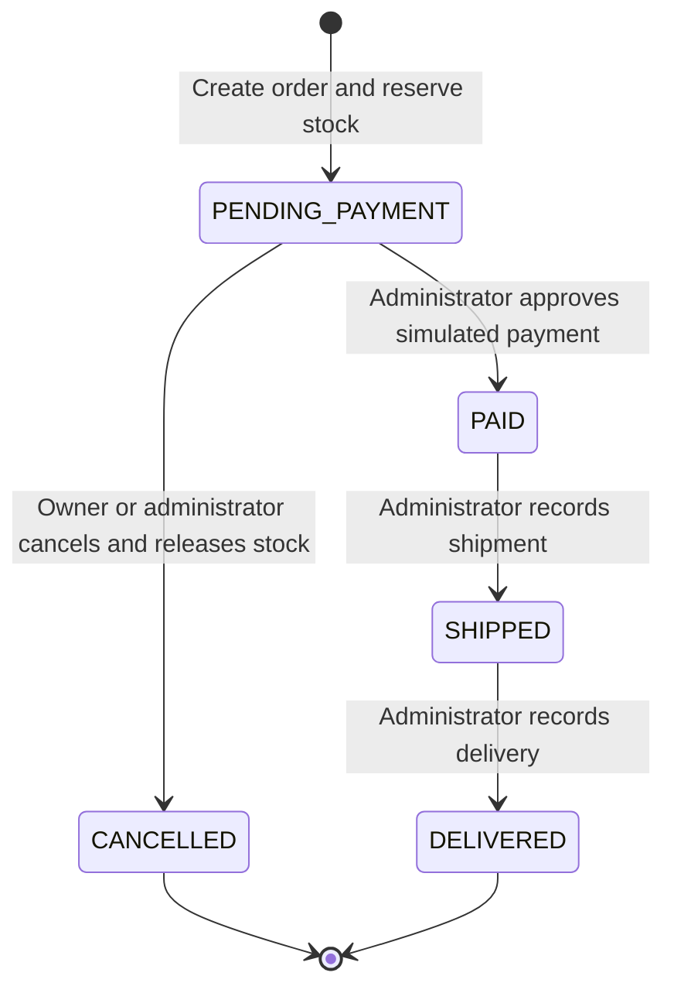

# Stage 1: requirements and business rules

Historical baseline: the later [Olist adaptation plan](../olist/adaptation-plan.md) supersedes fictional-only, single-store, product-level stock, historical payment/status, and source-time assumptions. Retain applicable operational safeguards, adapted to seller offers. This original document is preserved as a record of the earlier design, not the current Olist contract.

Status: proposed implementation contract, awaiting technical review. No API behavior described here is implemented in this new repository yet.

## Scope and architecture

Build one fictional store as a Django monolith with DRF JSON endpoints and PostgreSQL. Use domain modules for accounts, catalog, inventory, orders, and reports. Serializers validate HTTP shape; application services enforce business operations and transactions; models/migrations enforce local relational constraints. Read selectors and parameterized SQL provide reports. Avoid a generic repository layer over the ORM.

Include customer registration/login, self-profile, administrative customer management, products, orders with multiple items, a stock ledger, cancellation, and administrative processing. Use simulated payment approval and shipment/delivery records to make the reused lifecycle explicit.

Exclude real payment providers, card data, refunds/returns, discounts, shipping charges, extra taxes, multiple currencies, warehouses, automatic reservation expiry, public deployment, and creation idempotency keys. Orders awaiting payment can retain stock indefinitely; administrators can find and cancel old pending orders. Repeating order creation may create another order and is subject to the same stock checks.

All code identifiers, tables, columns, meaningful comments/docstrings, routes, messages, errors, and documentation must be English. User-facing explanations in the development conversation are Brazilian Portuguese. Historical work is preserved in its original repository.

## Identity, authorization, and data access

| Operation | Anonymous | Active customer | Active administrator |
| --- | --- | --- | --- |
| Register, obtain tokens | Yes | Yes | Yes; registration still creates only a customer |
| Refresh tokens | Valid refresh token required | Valid refresh token required | Valid refresh token required |
| Read/update own profile | No | Own allowed fields | Own allowed fields |
| Read active products | No | Yes | Yes |
| Create/update/deactivate products; view inactive products | No | No | Yes |
| List/read/update/deactivate customers | No | No | Yes |
| Create orders | No | For self only | No; use a separate customer account |
| List/read orders | No | Own only | All |
| Cancel pending order | No | Own only | Any customer order |
| Approve simulated payment; ship; deliver | No | No | Yes |
| Enter/adjust stock; read balances and movement history | No | No | Yes |
| Business reports and SQL analysis endpoints | No | No | Yes |

An administrator is an active Django user with `is_staff=True`; superusers may also be administrators. Do not expose promotion, permissions, staff flags, password hashes, or customer ownership as writable profile fields. Provision administrators through a controlled Django management operation, never public registration. Staff accounts do not purchase through administrative endpoints.

Email login is case-insensitive. Normalize outer whitespace and email case, enforce case-insensitive uniqueness in the database, require a nonblank name, and apply Django password validators and hashing. Never return a password or hash. Profile edits permit name and phone; login-email changes, password reset/recovery, and role changes are outside the initial API. Administrators can edit customer name/phone and deactivate/reactivate customers; they cannot read credentials or assign roles through customer management. Deactivation retains all history and blocks subsequent authentication/refresh/API access. An already-authorized in-flight transaction may finish; immediate revocation of in-flight work is not promised.

Scope customer querysets by owner **before** object lookup, returning `404` for another customer's identifier. Apply explicit role checks as well as object checks; accepting a valid JWT alone never grants administrative access. Services must also validate their caller so a direct service invocation cannot bypass the API permission layer.

## Validation and numeric rules

| ID | Rule |
| --- | --- |
| BR-01 | Product SKU is unique, 1-64 uppercase letters/digits/dot/underscore/hyphen, beginning with a letter or digit. SKU is immutable after product creation. Product name is nonblank and at most 200 characters. |
| BR-02 | Current product price and historical item price are finite decimal BRL values from `0.01` through `99999999.99`. Accept decimal strings, reject excess decimal places and non-finite values; never calculate money with binary floating point. |
| BR-03 | An order contains 1-100 distinct products. Each quantity is a JSON integer from 1 through 9999; reject booleans, fractional values, null, and numeric strings. Reject duplicate products rather than silently combining them. |
| BR-04 | Product IDs must exist and products must be active at purchase time. Validate all lines before completing the transaction. A product may be renamed, repriced, or deactivated later without invalidating existing orders. |
| BR-05 | The server assigns customer, prices, snapshots, total, currency, state, and timestamps. Reject supplied protected/unknown fields with `400`, rather than ignoring attempted overrides. |
| BR-06 | Every item stores `unit_price`, `product_sku`, and `product_name` as purchase-time snapshots. Items, quantities, buyer, currency, and shipping address cannot be edited after creation. Correct a pending order by cancelling and creating another. |
| BR-07 | `total = SUM(quantity * unit_price)`, calculated with `Decimal` on the server. Require a positive finite total fitting `numeric(16,2)`. Items use `numeric(10,2)`. No additional rounding is needed for integer quantities and two-decimal unit prices. |
| BR-08 | Currency is always `BRL`. Store timestamps with time zone; use UTC instants and `America/Sao_Paulo` for report calendar boundaries. |
| BR-09 | Require a structured Brazilian shipping address: recipient, street, number, district, city, valid two-letter state, eight-digit postal code, and fixed country `BR`. Complement is optional. Store it on the order as a historical snapshot. No real address verification is claimed. |
| BR-10 | Available stock is an integer in `0..2147483647`. Start a product with zero stock; initial supply uses an auditable `ENTRY`. No balance-only edit is allowed. |
| BR-11 | Inventory adjustments require a nonzero signed integer delta, a nonblank reason of at most 500 characters, and the authenticated administrator as actor. `ENTRY` must be positive. A negative adjustment cannot consume stock already reserved because it can reduce only currently available units. |
| BR-12 | To preserve cancellation headroom, an administrative increase must also keep `available_quantity + pending_reserved_quantity <= 2147483647`. Derive pending reservations from items of `PENDING_PAYMENT` orders under the product lock. This is a service invariant across tables, not a row CHECK. |

Stock transfers and fractional/weighted products are excluded. Lists are paginated with default size 20 and maximum 100, using deterministic ordering with an ID tiebreaker. Scalar summary reports are not collections; SQL scripts may explicitly export their complete result sets.

## Stock strategy and audit rules

Use **deduct-on-order-creation**, described as a reservation against available units. Do not maintain a second independently writable reserved-stock counter.

| Event | Available-stock delta | Ledger type |
| --- | --- | --- |
| Product created | 0 | No movement until supply is added |
| Administrative supply | Positive integer | `ENTRY` |
| Administrative correction | Nonzero signed integer | `ADJUSTMENT` |
| Order created | `-quantity` for each item | `RESERVATION` |
| Simulated approval, shipment, delivery | 0 | No new stock movement |
| Pending order cancelled | `+quantity` for each item | `RELEASE` |

Example: 10 available units, order for 3 -> 7 available. Payment, shipping, and delivery leave 7. Cancelling while pending returns 3 -> 10. The physical warehouse count is not separately tracked; the available balance excludes outstanding reservations and completed sales.

| ID | Rule |
| --- | --- |
| BR-13 | Creation writes order, all items, stock deductions, and reservation movements in one `transaction.atomic()` block. Insufficient stock or any write error rolls back **everything**, including lines already processed. |
| BR-14 | Every stock change has one immutable movement with product, signed delta, actor, reason, and timestamp. Reservation/release also link the order. Entries/adjustments do not link an order. Reconcile stock as the sum of all signed movements from the zero initial balance. |
| BR-15 | A reservation delta equals the negative item quantity; a release equals that same historical quantity. Enforce at most one movement per `(order, product, movement_type)` for reservation/release. Never edit/delete a movement to correct stock; append a justified adjustment. |
| BR-16 | Only `PENDING_PAYMENT` can be cancelled. Cancellation locks the order, validates its ledger, restores each item even if its product is now inactive, appends releases, and sets `cancelled_at`, all atomically. |
| BR-17 | Repeating cancellation on a consistent `CANCELLED` order by an authorized actor returns that order without new movements, timestamp changes, or stock changes. A cancelled order cannot be reopened. |
| BR-18 | Do not expose direct balance, item, payment, shipment, timestamp, or arbitrary status writes. Integrity conflicts fail without attempting to fabricate or silently repair history. |

Deactivating a customer does not cancel their pending orders automatically; an administrator can cancel them. Deactivating a product prevents new purchases but preserves existing processing and cancellation. Deactivation never removes reservations or ledger entries.

## Order lifecycle

| ID | From | To | Required behavior |
| --- | --- | --- | --- |
| BR-19 | No order | `PENDING_PAYMENT` | Active customer creates for self; snapshot purchase data and reserve all stock atomically |
| BR-20 | `PENDING_PAYMENT` | `PAID` | Administrator records one simulated payment with server-computed amount equal to the order total and approval time equal to `paid_at`; never a real charge |
| BR-21 | `PENDING_PAYMENT` | `CANCELLED` | Owner or administrator restores stock once; no payment or shipment may exist |
| BR-22 | `PAID` | `SHIPPED` | Administrator creates one shipment with optional fictional tracking code, at most 100 characters; preserve payment and stock |
| BR-23 | `SHIPPED` | `DELIVERED` | Administrator records delivery on the same shipment; preserve payment and stock |
| BR-24 | Any other pair | Rejected | No skipped, reversed, reopened, or paid-order cancellation transitions |

Order timestamps must match their state and be chronological: creation <= payment <= shipment <= delivery, or creation <= cancellation. The service also checks that payment/shipment records match the order's values and times. `CANCELLED` and `DELIVERED` are terminal.

Repeating simulated approval in `PAID`, `SHIPPED`, or `DELIVERED` returns the existing consistent payment, preserving state and timestamps. Repeating shipping in `SHIPPED` or `DELIVERED` is allowed only with the same tracking data. Repeating delivery in `DELIVERED` preserves the original time. Missing or inconsistent associated records produce an integrity conflict. Repetitions still require authorization.

## Transactions, locking, and concurrent requests

Use PostgreSQL's default `READ COMMITTED` isolation with explicit row locks; do not infer concurrency guarantees from SQLite or from transaction boundaries alone.

1. For an existing-order operation, lock that order with `SELECT ... FOR UPDATE` before inspecting state, items, or lifecycle records. No such lock is needed before creating a new order.
2. For every operation touching inventory or product price/activation, acquire all relevant product locks in ascending product ID order. Fully evaluate this ordered lock query before proceeding.
3. Acquire all relevant stock locks in the same ascending product ID order **after** the product locks. Product creation and its zero stock row commit together.
4. Re-read active status, prices, balances, and required invariants after acquiring locks. Create the order and snapshot rows only from those locked values. Never reuse pre-lock balance checks as authorization to deduct stock.
5. Hold locks until order, items, balances, and ledger commit or roll back. Inventory adjustments and catalog changes use the same product-then-stock discipline. Do not introduce an inverse stock-to-product or product-to-existing-order lock dependency.

For the last unit, the first transaction reserves it; a second transaction waits, then observes zero and fails with no partial order. For payment racing cancellation, the order lock permits exactly one legal transition; the loser re-reads state and fails. For two cancellations, one restores stock and the other returns the existing cancellation. For overlapping multi-product orders, ascending lock order prevents opposite product-lock acquisition order.

The cancellation-headroom calculation reads pending quantities while holding the product lock. Creation/cancellation of those reservations must also hold that lock; payment can only reduce the pending amount. This can conservatively reject an increase during a simultaneous approval but cannot allow an overflow on release.

Do not automatically retry creation after connection failure or ambiguous commit; without an idempotency key, a client retry could duplicate an order. Lock/deadlock/database failures must roll back the operation and produce a sanitized failure response. Production retry policy and network-level exactly-once creation are outside this version.

## Deletion and integrity boundaries

No domain hard-delete endpoints. Products and users are deactivated; orders, items, ledger entries, payments, shipments, and customer records are retained. Use Django `on_delete=PROTECT` on historical FKs, with real PostgreSQL FKs preventing dangling references. Do not claim that Django `PROTECT` is a PostgreSQL trigger or an immutable-history mechanism.

Database row checks enforce signs, ranges, required values, state/timestamp combinations, and chronology; unique constraints enforce identities and duplicate-effect protection. Transactions and services enforce cross-table totals, nonempty orders, exact stock/item/movement correspondence, state transitions, purchase snapshot immutability, and payment consistency. No CHECK may query another table. Direct SQL with privileged write credentials can bypass the service invariants; this limitation must remain explicit. The API exposes no history mutation, and migrations/bootstrap privileges must be separated from any future restricted reporting account.

## API and security contract

Keep English action routes such as `/api/accounts/register/`, `/api/accounts/token/`, `/api/accounts/token/refresh/`, `/api/accounts/me/`, `/api/customers/`, `/api/products/`, `/api/inventory/`, and `/api/orders/`. Existing-order actions use `/api/orders/{id}/cancel/`, `simulated-payment/`, `ship/`, and `deliver/`. Final schemas and operation names will be generated and verified with implementation.

Use Bearer JWT authentication through DRF and Django users. Proposed lifetimes: access 5 minutes, refresh 1 day. Use HS256 with a high-entropy environment-provided signing secret, fixed issuer/audience, and explicit algorithm validation. Check the current database user for active status and permissions; reject tokens after password changes using the chosen library's verified revocation mechanism. No server logout/refresh blacklist is promised in the first version; document that a valid stolen refresh token can remain usable until expiry or account/password invalidation.

Use environment variables for database credentials, Django secret, and token signing configuration. Commit only a placeholder `.env.example`. Do not print tokens, passwords, environment contents, or real credentials in test/benchmark evidence. Store demo passwords with Django hashing. Bind local services to loopback; Docker execution is a development environment, not a production deployment. Parameterize SQL and use the ORM; never interpolate HTTP values into SQL identifiers or expressions.

Expected responses: `201` for creation, `200` for reads/updates/actions and valid action repetitions, `400` for invalid input, `401` for absent/invalid credentials, `403` for an authenticated forbidden role, `404` for missing/foreign-owned resources, and `409` for insufficient stock, illegal transitions, conflicting repeat data, stock-limit conflicts, or detected business-integrity conflicts. Unexpected database failures produce a sanitized `500`, never SQL text or secrets. English stable error codes/messages and OpenAPI examples are required in their implementation stages.

## SQL reporting semantics and experiment contract

Revenue and sales reports count only simulated approved payments whose orders currently have status `PAID`, `SHIPPED`, or `DELIVERED`. Use payment approval time, a start-inclusive/end-exclusive interval, and calendar months in `America/Sao_Paulo`. Cancelled and pending orders contribute zero sales. No refunds exist. Each query explanation must state its own rule; order-detail and customer-coverage reports intentionally include all order states.

| Business question | Required SQL features | Result and empty-set contract |
| --- | --- | --- |
| Order details with customer and product information | `INNER JOIN` across order, items, customer, user, product | One row per item; show purchase snapshots alongside explicitly labeled current product data; include cancelled orders with status; zero rows if none |
| Customers with and without orders | `LEFT JOIN`, `COUNT(order.id)`, `GROUP BY` | One row per customer, counting all statuses; zero for no orders; zero rows if no customers |
| Products selling at least a supplied positive unit threshold | Eligible-sales CTE, `SUM`, `GROUP BY`, `HAVING` | Aggregate historical item quantities/value; exclude pending/cancelled; zero rows when no product meets threshold |
| Monthly simulated sales | CTE, `date_trunc`, aggregates, month calendar/left join | Show all requested whole calendar months, including zero-value months; reject invalid/reversed intervals |
| Customer spending rankings | Eligible-sales aggregate CTE, `DENSE_RANK()` | Include customers with no sales at zero; equal spending shares a rank; deterministic display by customer ID |
| Running monthly revenue | Monthly CTE, `SUM(...) OVER (ORDER BY month ROWS BETWEEN UNBOUNDED PRECEDING AND CURRENT ROW)` | Running sum over the requested zero-filled monthly series only |
| Product sales rankings | Aggregate CTE, `DENSE_RANK()` and/or `ROW_NUMBER()` | Rank eligible units/revenue, explain ties and tiebreakers, zero rows if no sales |

Do not multiply order/payment totals by joining them directly to multiple items before aggregation. Preserve distinct product identities when names change. Tests will compare SQL results with explicit fixture expectations, including cancelled, empty, zero-order, tie, and month/time-zone-boundary cases. Publish only results from executed queries.

Candidate optimization: the oldest pending orders, filtered by fixed cutoff and ordered by `created_at, id` with `LIMIT 20`; compare against a partial index on `(created_at, id) WHERE status = 'PENDING_PAYMENT'`. Selectivity and ordering might help, but no gain is assumed. If the candidate already exists in adopted migrations, omit only that non-unique index in the isolated benchmark baseline; retain every integrity constraint and restore the final schema afterward.

Stage 5 must use one isolated, seeded, larger database (initial target: 500 customers, 1000 products, 20000 orders), separate from the small demo database. Compile/freeze identical SQL and parameters, fingerprint data and ordered results, refresh statistics with `VACUUM (ANALYZE)`, warm up at least twice per phase, collect at least seven measured runs per phase using `EXPLAIN (ANALYZE, BUFFERS, FORMAT JSON)`, and compare baseline/index/control-baseline results. Preserve plans, each execution time, medians, environment versions, relevant settings, row counts, buffer activity, index bytes, and cache/measurement limitations. Do not disable sequential scans to manufacture improvement. Cache conditions are warm shared/OS caches unless explicitly measured otherwise; a new connection is not a cold cache.

## Stage acceptance and test plan

| Stage | Required implementation evidence before review |
| --- | --- |
| 1 | Workspace assessment, complete proposed rules, permissions, lifecycle, ER model, integrity boundaries, real documentation checks; no application implementation |
| 2 | Supported pinned environment; PostgreSQL connection/version; Django checks; migrated clean database; no migration drift; constraint tests; schema-only export and isolated restoration verification |
| 3 | Registration/JWT/profile/products/admin-customer API tests, strict validation, owner isolation, privilege escalation rejection, active-user behavior, collection pagination |
| 4 | Price/name/SKU snapshots; server totals; multi-item purchase; last-line insufficient-stock rollback; injected late-write rollback; stock ledger reconciliation; cancellation/repetition; prohibited states; inactive-product history; headroom boundaries; controlled PostgreSQL races |
| 5 | Repeatable fictional demo and benchmark commands; refused nonempty/wrong databases; Django-hashed demo passwords; SQL report correctness tests; actual query output; plans, samples, medians, result equivalence, storage cost, honest interpretation |
| 6 | English README and guides; working Docker execution; OpenAPI; curl workflows; architecture/database/SQL explanations; complete relevant test execution; limitations; all evidence linked |

Concurrency tests must use transaction-capable PostgreSQL test cases with separate connections/backend PIDs and controlled events/barriers. Observe a real lock wait with `pg_blocking_pids()` before releasing the first transaction. Test the last available units, overlapping products in reversed input order, double cancellation, and approval racing cancellation. Small bounded polling is acceptable for observing a lock, but arbitrary sleeps alone are not coordination. Assert committed orders, stock, movements, and losing outcomes after threads finish.

Record the exact commands and actual results at each stage. Do not state that a test or benchmark passed unless executed. Failures and unavailable services remain visible. Stop for technical review at every stage; commits and GitHub publication do not imply approval to begin the next stage.

Each stage must also receive an independent review following the [review process](../review-process.md). Address material findings and verify corrections before handoff. This review is additional to the user's stage approval.
