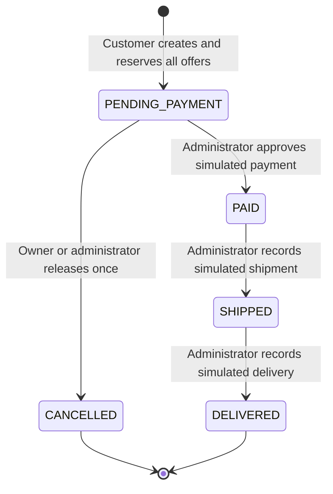

# Stage 4: operational contract

This implements the approved operational rules from Stage 1, adapted to seller offers by the Olist design. Historical `olist_*` facts remain read-only and never enter operational stock, cancellation, payment, or shipment services. All new operational records are explicitly `SIMULATED_API`.

## Purchase and inventory

- Only active nonstaff customers purchase for themselves. Accept 1–100 distinct offers with integer JSON quantities 1–9999. The same product from different sellers is valid; duplicate offer lines are rejected. The server sets customer, status, timestamps, BRL currency, unit prices, immutable name/SKU/seller snapshots, and decimal total.
- A purchase requires active sellers, products and offers, initialized stock, sufficient units, and a structured Brazilian address. No item/address/ownership/total edits or hard deletion are exposed afterward. There are no discounts, taxes, shipping charges, other currencies, reservation expiry, or creation idempotency keys.
- Deduct available stock at order creation and append one negative `RESERVATION` per offer in the same transaction as order/items. Failure of any line or write rolls everything back. Payment, shipping and delivery do not change stock. Physical stock is not separately modeled.
- Administrative `ENTRY` is positive; `ADJUSTMENT` is signed and nonzero. Every change appends an actor, timestamp and mandatory reason. No balance-only mutation is exposed. Stock reconciles to the sum of its immutable movements from zero.
- While holding offer/stock locks, require `new_available + pending_order_quantities <= 2147483647`, preserving capacity for all cancellable reservations. Inventory services never lock existing orders after stock locks. Concurrent payment can only reduce this liability, so a conservative capacity refusal is acceptable.

## Lifecycle

Only pending orders can be cancelled. Restore all offer quantities even when catalog objects are inactive; an administrator can cancel an inactive customer's order. Record the actual cancelling actor, which may differ from the buyer. Past administrative authorization is not inferred from the actor's current staff status.

Repeating a consistent cancellation returns the original order without another release or timestamp change. Repeating simulated payment in paid/shipped/delivered states returns the existing payment. Repeating shipping in shipped/delivered states requires the original tracking code; repeating delivery is allowed only when delivered. No skipped, reversed, reopened or paid-order cancellation transitions are allowed. Inspect items/total, reservation/release, payment and shipment consistency before returning either a transition or a repetition. Conflicts never fabricate repairs.

## Transactions, authorization and responses

Lock order is **existing order → sellers ascending ID → products ascending ID → offers ascending ID → stock ascending offer ID**. Deduplicate parent identities and fully evaluate each locking query. Offer parents are database-immutable. Creation, cancellation, catalog edits and inventory changes follow this relative hierarchy; no joined locking query acquires hidden parent locks. Re-read mutable activation, labels, prices and balances after locks. PostgreSQL uses READ COMMITTED.

Customer querysets are owner-filtered before lookup; foreign-owned IDs return 404. Services recheck current active customer/admin state; staff accounts cannot purchase. Capture action response history under the order lock to avoid mixing concurrent states. Allowed in-flight work can finish after account deactivation; immediate revocation of work already authorized is not promised.

Use 201 for creation, 200 for reads/actions/repetitions, 400 for invalid inputs, 401/403 for authentication/role failures, 404 for missing/foreign-owned orders, and 409 for insufficient stock, invalid transitions, conflicting repeat data, capacity or detected business-integrity conflicts. Unexpected database failures return a sanitized 500 and roll back the active transaction. Never automatically retry order creation after an ambiguous commit; a client retry can create another order.

Database constraints enforce keys, references, local ranges and state/timestamp combinations. Services enforce nonempty orders, server totals, snapshots, transitions and ledger consistency. Privileged direct SQL can bypass service-level invariants; this is not a tamper-proof accounting system. Real payment/refund/return processing, separate seller suborders/fulfillment, public deployment, SQL portfolio and index measurements remain outside this stage.
